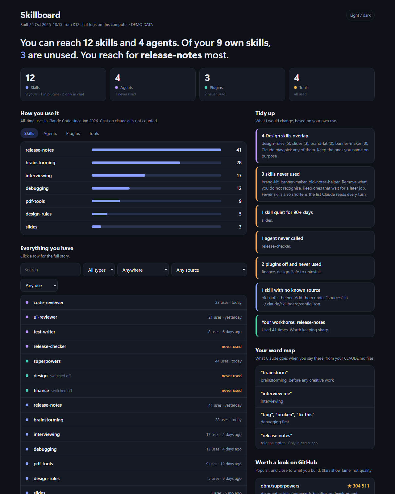

# Skillboard

One clean page that shows what you have in Claude Code, how you use it, and what to tidy up.



Claude Code does not show your skills, agents and plugins in one place. It does not show how often you use them, or where they came from. Skillboard reads the files already on your computer and builds a single web page from them.

## What you get

- **A plain headline.** For example: "You can reach 119 skills and 17 agents. 3 of your own skills are unused."
- **How you use it.** All-time uses of every skill, agent, plugin and tool, with bars. Last used dates too.
- **Tidy up.** Skills that overlap, skills never used, agents never called, plugins switched off, skills that exist twice, skills with no known source.
- **Everything you have.** A searchable list. Filter by type, where it works, source and use. Click a row to see what to say to trigger it, the slash command, its source and its file.
- **Your word map.** The tables in your `CLAUDE.md` files that map your words to skills.
- **Worth a look on GitHub.** Up to 5 popular repos that fit what you already use, with live star counts.

## Install

You need Python 3.9 or newer. There is nothing to `pip install`.

```bash
git clone https://github.com/jasonlohyp/skillboard.git
cd skillboard
python skillboard.py --demo      # try it with fake data first
python skillboard.py             # your real data
```

Use the `/skillboard` command inside Claude Code:

```bash
python skillboard.py --install-command
```

Pin it on Windows: run `powershell -ExecutionPolicy Bypass -File install-shortcut.ps1`. It adds **Skillboard** to the Start Menu with an icon. Right-click it and choose **Pin to taskbar**.

## Always fresh

Skillboard rebuilds the page every time you run it. Open it from the shortcut, the command or `python skillboard.py`. Opening the saved HTML file by hand shows old numbers.

## What it reads

Everything stays on your computer. Skillboard only reads. It never changes your Claude files.

| File | Used for |
|---|---|
| `~/.claude/skills/`, `~/.claude/agents/`, and `.claude/` folders in your projects | The list of skills and agents |
| `~/.claude.json` | Claude Code's own all-time use counters |
| `~/.claude/projects/**/*.jsonl` | Chat logs: agent, tool and slash command use |
| `~/.claude/settings.json` | Which plugins are switched on |
| `~/.agents/.skill-lock.json` | Where skills installed with `npx skills add` came from |
| `CLAUDE.md` files | Your word map |
| The Claude desktop app's plugin folder (Windows) | Plugins and Cowork sessions |

The only network call is the GitHub lookup, `api.github.com/repos/...`, for star counts. It is cached for 12 hours. Skip it with `--offline`.

## Your settings

Skillboard keeps your own files in `~/.claude/skillboard/`. They never go in this repo.

`config.json` (all parts are optional):

```json
{
  "sources": { "my-skill": ["owner/repo", "https://github.com/owner/repo"] },
  "keep": ["skill-i-want-to-keep"],
  "mine": ["skill-i-wrote"],
  "overlapGroups": { "My group": ["skill-a", "skill-b", "skill-c"] },
  "githubPicks": [{ "repo": "owner/repo", "why": "Why it fits me", "tags": ["word", "in", "my", "skills"] }]
}
```

- **sources:** tell Skillboard where a skill came from. It also looks for an install record, a repo link in the skill's header and a `.git` folder.
- **keep:** skills you want to keep, so they never show as "never used".
- **mine:** skills you wrote. Their source shows "You".
- **overlapGroups:** sets of skills that do the same job. Skillboard warns when you have three or more from one set.
- **githubPicks:** your own list for "Worth a look". `tags` are words. Repos whose tags appear in your skills rank first.

`chat-skills.json` holds a saved copy of skills on your claude.ai account. They are not on your computer, so Skillboard cannot read them. `/skillboard` can refresh the copy when Claude has the `ListSkills` tool.

## Change the words and numbers

Nothing about the tips is buried in the code:

- `defaults.json` holds the numbers (days before a skill counts as quiet, how long the skill list may be) and the built-in overlap groups. Override any of them in `config.json` under `"thresholds"` and `"overlapGroups"`.
- `messages.json` holds the text of every Tidy up card. Edit the words, or translate them.
- `known_sources.json` and `github_candidates.json` are plain lists you can edit.

## Good to know

- **Use counts cover Claude Code only.** Claude chat on the web is not counted.
- **Chat logs are cleaned up by Claude Code after some weeks.** The all-time counter in `~/.claude.json` is the longer record. Skillboard shows the larger of the two.
- **It reads files Claude Code does not document.** `~/.claude.json` and the log format can change in an update. If a number looks wrong after an update, open an issue.
- **Windows is tested. macOS and Linux are best effort.** The core files use `~/.claude`, which is the same everywhere. The desktop app plugin folder is only searched where it is known.
- **Source "(likely)"** means the name matched a skill in `known_sources.json`. Names can clash, so check it. Add the exact source to `config.json` to remove the word.
- **Source "Not recorded"** means no install record exists. That happens when you copy a folder or download a ZIP. Add the source to `config.json`.

## Tests

```bash
python -m unittest discover tests
```

## License

MIT. See `LICENSE`.
